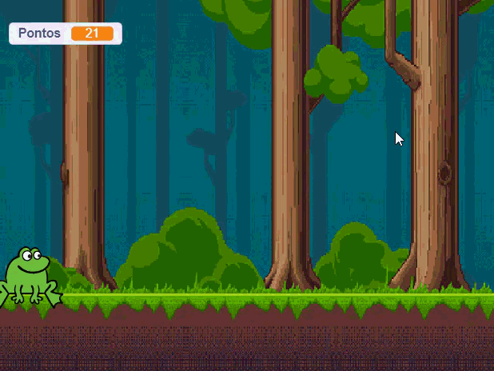

# 🐸 Jump Frog

> 🔗 **Acesse e jogue o projeto:** [Clique aqui para jogar e ver o código no Scratch](https://scratch.mit.edu/projects/1392093174)

## 📸 Demonstração do Jogo

Projeto de um jogo estilo Endless Runner desenvolvido em Scratch como parte dos meus estudos de programação no CS50x, inspirado no clássico jogo do dinossauro do Google.

---

## 🚀 Sobre o projeto

O jogo consiste em controlar um sapo corajoso que precisa desviar de obstáculos aleatórios para sobreviver o máximo possível e acumular pontos. O projeto conta com sistema de dificuldade progressiva, gerenciamento de estados e telas interativas.

---

## 🛠️ Tecnologias e Conceitos utilizados

- Scratch (scratch.mit.edu)
- Estruturas condicionais (`se... então`)
- Laços de repetição (`sempre`)
- Variáveis globais para pontuação, controle de estado e tempo de deslize
- Comunicação via mensagens (`transmita`)
- Blocos personalizados com passagem de parâmetros (*Make a Block*)

---

## 🎮 Funcionalidades e Regras do Jogo

- **Como Jogar:** Pressione a tecla **Espaço** para fazer o sapo saltar e desviar dos bichinhos.
- **Sorteio Dinâmico:** O palco gerencia o fluxo do jogo e sorteia de forma sincronizada entre três obstáculos diferentes (`Chick`, `Crab` e `Parrot`), garantindo que apenas um apareça por vez.
- **Dificuldade Progressiva:** Conforme o jogador acumula pontos, a velocidade de deslocamento dos obstáculos aumenta automaticamente, elevando o desafio.
- **Sistema de Game Over:** Detecção precisa de colisão que encerra a partida e muda para o cenário de fim de jogo com segurança.

---
